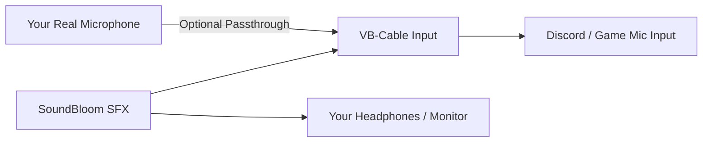

# 🌸 SoundBloom
> **Your Sound, Your World.**  
> A modern, high-performance, open-source soundboard for Windows 10 and 11.  
> *The next-generation, free alternative to Soundpad.*

[](https://github.com)
[](https://dotnet.microsoft.com/)
[](https://github.com)
[](https://github.com)
[](LICENSE)

---

## 🎧 What is SoundBloom?

**SoundBloom** is a sleek, commercial-grade soundboard built from the ground up to replace outdated tools like Soundpad. Designed with a gorgeous dark cyber-aesthetic (graphite, neon purple, and cyan accents), SoundBloom lets you play sound effects, memes, music clips, and sound bites directly into your voice calls (**Discord, TeamSpeak, Skype, WhatsApp**) and games (**CS2, Valorant, Call of Duty, Fortnite, FiveM, Roblox**) with crystal-clear 48kHz audio and near-zero latency.

Whether you're streaming, gaming with friends, or hosting a podcast, SoundBloom delivers the soundboard experience modern Windows users deserve.

---

## ✨ Features at a Glance

- 🔄 **Modern Soundpad Alternative**: Enjoy full functionality without trial popups, audio compression limits, or outdated Windows 7-era interfaces.
- 🔊 **True Dual-Stream Audio Routing**:
  - **Monitor (Headphones/Speakers)**: Hear your sounds locally in real time.
  - **Broadcast (Virtual Cable / Call Output)**: Transmit pristine sound effects directly into your Discord, games, and streaming apps.
  - *No sample-sharing stutter, no 2x speed bugs, and zero white noise.*
- 🎙️ **Microphone Passthrough**: Blend your real microphone input with your soundboard effects into a single virtual stream, with customizable gain and clipping protection.
- ⚡ **Global Low-Level Hotkeys (`WH_KEYBOARD_LL`)**: Trigger sounds instantly while gaming in full-screen or while SoundBloom is minimized to the system tray.
- 🛑 **Panic Button (`Ctrl+Alt+S`)**: Instantly silence all playing sounds with a single global key combination.
- 🎛️ **Visual Soundboard Grid (4x3 Pads)**: 4 pages of 12 responsive sound pads (48 quick-fire slots) with custom colors, labels, and live playback animations.
- 📂 **Universal File Support**: Seamlessly import `.mp3`, `.wav`, `.ogg`, `.flac`, `.m4a`, and `.aac` via drag-and-drop or folder batch import.
- 💾 **Reliable SQLite Persistence**: Sounds are copied safely to `%APPDATA%\SoundBloom\Audios` and tracked in SQLite. Deleted sounds stay deleted; imported sounds are never lost.
- 🚀 **Single-File Standalone Executable**: No installer required, no dependency hell, and no loose DLL files cluttering your Desktop.

---

## 🚀 How to Install

### Option A: Portable Single File (Recommended)
1. Download **`SoundBloom.exe`** from the latest [Releases](../../releases) section.
2. Place it anywhere you like (e.g., your Desktop or a dedicated folder).
3. Double-click to launch! SoundBloom is completely self-contained and ready to play.

### Option B: Windows Installer Setup
1. Download **`SoundBloom-Setup.exe`**.
2. Run the installer and choose whether to create shortcuts on your Desktop and Start Menu.
3. Launch SoundBloom from your Start Menu.

---

## 🛠️ How to Use SoundBloom

### 1. Setting Up Audio for Discord, Games & Calls

To play sounds directly into voice calls like Soundpad does, SoundBloom uses a virtual audio cable (such as **VB-Audio Virtual Cable**, which is free and standard):



#### Step-by-Step Configuration:
1. **Install VB-Audio Cable** (if not already installed). You can download it free from [vb-audio.com/Cable](https://vb-audio.com/Cable/) or run the bundled installer in `Drivers/VBCable/VBCABLE_Setup_x64.exe`.
2. Open **SoundBloom** and click the **Settings** icon (gear in the sidebar).
3. Configure your devices:
   - **Playback Device (Monitor)**: Select your everyday headphones or speakers.
   - **Broadcast Device (Calls/Discord)**: Select **`CABLE Input (VB-Audio Virtual Cable)`**.
   - **Microphone Device**: Select your physical microphone (headset or USB mic).
   - **Enable Microphone Passthrough**: Turn this **ON** if you want your voice and soundboard to go through the same virtual cable into your call.
4. Open **Discord** (or your game's audio settings):
   - Go to **Settings** > **Voice & Video**.
   - Set **Input Device (Microphone)** to: **`CABLE Output (VB-Audio Virtual Cable)`**.
   - Set **Output Device** to: Your headphones.
   - *(Optional Discord tip)*: In Discord, turn off *Noise Suppression (Krisp)* and set *Input Sensitivity* to manual so quiet soundboard audio isn't filtered out.

---

### 2. Adding and Managing Sounds

- **Drag and Drop**: Simply drag audio files (`.mp3`, `.wav`, `.ogg`, `.flac`, `.m4a`) from Windows Explorer directly into the SoundBloom window.
- **Import Button**: Click the **"+ Importar Áudios"** button on the top right to choose individual files or entire folders.
- **Categories & Playlists**: Organize your library into categories (Gaming, Memes, Music, Reactions, SFX) or custom playlists.
- **Search & Sort**: Type in the top search bar to find any sound instantly by name, or sort by date added, duration, or alphabetical order.
- **Editing Sounds**: Right-click any sound to rename it, adjust its individual volume, set fade-in/out times, toggle looping, or assign a global hotkey.

---

### 3. Using Global Hotkeys

You can trigger any sound effect even while playing games in full-screen mode:
1. Click on the sound item's hotkey button (or right-click > **Editar**).
2. Press the desired key combination (e.g., `Ctrl+1`, `Alt+NumPad 5`, `F8`).
3. Press **Salvar**.
4. Now, pressing that hotkey from anywhere inside Windows will immediately trigger the sound!

#### Essential Built-In Shortcuts:
| Shortcut | Action |
| :--- | :--- |
| `Ctrl + Alt + S` | **PANIC STOP**: Instantly silences all active sound effects |
| `Ctrl + Space` | **Pause / Resume** active sound effects |
| `Ctrl + 1` to `Ctrl + 7` | Quick triggers for starter demo sounds |

---

### 4. Soundboard Pad Grid Mode

Click **"Soundboard"** in the sidebar to switch to the visual tactile grid:
- **4x3 Pads (12 per page, 4 pages total = 48 pads)**.
- Assign sounds directly to pads for quick one-click triggering during streams or live voice chats.
- Live active pulse animation when a pad's sound is currently playing.

---

## 🏗️ Architecture & Tech Stack

SoundBloom is engineered with a modern, decoupled architecture:

- **Framework**: [.NET 8.0](https://dotnet.microsoft.com/) Windows Desktop (C# 12)
- **UI & Presentation**: WPF (Windows Presentation Foundation) with MVVM pattern and GPU-accelerated styling
- **Digital Signal Processing**: [NAudio 2.2.1](https://github.com/naudio/NAudio)
  - `WasapiOut` (Shared Mode, low-latency buffer)
  - High-precision `WdlResamplingSampleProvider` (48,000 Hz float mixing)
  - `MonoToStereoSampleProvider`
  - Dual-output independent buffer streaming (eliminating buffer racing)
- **Input System**: Win32 Low-Level Keyboard Hook (`SetWindowsHookEx` with `WH_KEYBOARD_LL`)
- **Database / Storage**: Embedded SQLite ([Microsoft.Data.Sqlite 8.0.10](https://www.nuget.org/packages/Microsoft.Data.Sqlite))

---

## 💻 Building from Source

### Prerequisites:
- Windows 10 (Build 19041+) or Windows 11
- [.NET 8.0 SDK](https://dotnet.microsoft.com/download/dotnet/8.0)

### Clone & Build:
```bash
git clone https://github.com/yourusername/soundbloom.git
cd soundbloom

# Build in Debug mode
dotnet build

# Run unit validation tests
dotnet run -- --test

# Publish standalone single-file executable
dotnet publish -c Release -r win-x64 --self-contained true -p:PublishSingleFile=true -p:IncludeNativeLibrariesForSelfExtract=true -p:EnableCompressionInSingleFile=true -o "dist\SoundBloom-Desktop"
```

---

## 📄 License

This project is open-source and released under the [MIT License](LICENSE). Feel free to use, modify, and contribute!

---

## 🌸 Credits & Acknowledgements

Created with passion for gamers, content creators, and streamers.  
*SoundBloom — Your Sound, Your World.*
